# Database Design — Entity-Relationship Diagram and Table-by-Table Specification

**Status: PROPOSED — Stage 1 gate not approved.** Corrected 2026-11-06 for the client decisions
(contractor commission, Admin-only finance, flexible billing, optional GST) — see
`docs/STAGE1_CORRECTION_TRACKING_MATRIX.md` (items DB-01…DB-23).

This is a **design document, not SQL**. `database.sql` is written in Stage 2, only after approval.

- **Conventions:** `project-context/DATABASE_RULES.md`.
- **Workflows:** `docs/WORKFLOWS.md`. **Permissions:** `docs/PERMISSION_MATRIX.md`.
- **Tags:** `CLAUDE.md` §3. Fields that depend on an open question say **PENDING (Q-…)**; they are
  kept in the design but stay unused until answered.

## 0. Notation

| Shorthand | Meaning |
|---|---|
| **PK / FK / UQ / IX** | primary key / foreign key (real constraint) / unique / indexed |
| **[STD]** | `created_at`, `created_by` (FK users), `updated_at`, `updated_by` (FK users) |
| **[SD]** | `deleted_at`, `deleted_by` (FK users) |
| **MONEY / RATE / AREA / PCT / QTY** | DECIMAL(14,2) / (12,2) / (12,2) / (5,2) / (10,2) |
| **status** | VARCHAR(30), fixed list in the application (D-07) |
| **lookup FK** | real FK to `lookups.id`; the application also checks `list_type` |
| **signed MONEY** | negative only on reversal or adjustment rows |
| **XOR(a,b,c)** | exactly one of the listed columns is non-NULL (application rule + test case) |
| **[FIN]** | financial data — ADM only (`BUSINESS_REQUIREMENTS.md` §4.1) |
| ◇ | optional feature: table created in the schema, feature switched off until decided |

**Totals:** 58 tables in 9 groups (was 49; +5 commission, +3 tax-line tables, +website enquiries inbox; credit transfers dropped — CD-68).
Client answers CD-31…CD-90 (2026-11-06) are applied in this version.

---

## 1. Entity-relationship diagram

```mermaid
erDiagram
    roles ||--o{ users : has
    roles ||--o{ role_permissions : grants
    permissions ||--o{ role_permissions : in
    users ||--o{ login_attempts : logs
    users ||--o{ password_resets : requests
    users ||--o{ audit_logs : performs

    service_categories ||--o{ service_items : contains

    referral_partners |o--o{ enquiries : "referred"
    referral_partners |o--o{ projects : "sourced"
    enquiries ||--o{ enquiry_services : wants
    service_categories ||--o{ enquiry_services : in
    enquiries |o--o| clients : "converted to"
    enquiries |o--o| projects : "converted to"
    enquiries ||--o{ activities : logs
    enquiries ||--o{ follow_ups : has
    enquiries ||--o{ quotations : "prospect quote"

    clients ||--o{ projects : owns
    projects ||--o{ project_members : staffed_by
    users ||--o{ project_members : member
    projects ||--o{ project_services : includes
    projects ||--o{ project_status_history : tracks
    projects ||--o{ site_visits : has
    site_visits ||--o{ site_visit_photos : has
    projects ||--o{ project_documents : stores
    files ||--o{ project_documents : file
    files ||--o{ site_visit_photos : file
    projects ||--o{ activities : logs
    projects ||--o{ follow_ups : has

    projects ||--o{ quotations : has
    quotations ||--|{ quotation_revisions : versions
    quotation_revisions ||--o{ quotation_scope_items : scope
    quotation_revisions ||--o{ quotation_fee_lines : fees
    quotation_revisions ||--o{ quotation_tax_lines : taxes
    quotation_revisions ||--o{ quotation_schedule_lines : schedule
    quotations ||--o{ quotation_status_history : tracks

    projects ||--o{ fee_agreements : "agreed fee (one active)"
    quotation_revisions |o--o| fee_agreements : "accepted as"
    fee_agreements ||--o{ fee_agreement_tax_lines : taxes
    fee_agreements ||--o{ fee_variations : varied_by
    fee_variations ||--o{ fee_variation_tax_lines : taxes
    fee_agreements ||--o{ fee_milestones : "payment stages"
    projects ||--o{ bills : billed
    fee_milestones |o--o{ bills : "billed via"
    bills ||--|{ bill_lines : lines
    bills ||--o{ bill_tax_lines : taxes
    bills ||--o{ credit_notes : reduced_by
    credit_notes ||--o{ credit_note_tax_lines : taxes
    projects ||--o{ payments : receives
    payments ||--o{ payment_allocations : allocates
    bills |o--o{ payment_allocations : "target (bills method)"
    fee_milestones |o--o{ payment_allocations : "target (agreement method)"
    fee_agreements |o--o{ payment_allocations : "target (agreement method)"
    payments |o--o| payments : reverses
    website_enquiries |o--o| enquiries : "converted to"
    projects ||--o{ refunds : refunds
    projects ||--o{ write_offs : writes_off
    projects |o--o{ expenses : incurs
    files |o--o{ expenses : receipt

    projects ||--o{ project_commissions : "commission (contractor source only)"
    referral_partners ||--o{ project_commissions : earns
    project_commissions ||--o{ commission_adjustments : adjusted_by
    project_commissions ||--o{ commission_payments : paid_by
    project_commissions ||--o{ commission_status_history : tracks
    commission_payments |o--o| commission_payments : reverses
    files |o--o{ commission_payments : proof

    portfolio_projects ||--o{ portfolio_images : shows
    files ||--o{ portfolio_images : file
    projects |o--o{ portfolio_projects : "published as"
    portfolio_projects ||--o{ portfolio_project_services : lists
```

---

## 2. Table list

| Group | Tables |
|---|---|
| A. Security & system (11) | `roles`, `permissions`, `role_permissions`, `users`, `login_attempts`, `password_resets`, `audit_logs`, `settings`, `number_sequences`, `lookups`, `files` |
| B. Services (2) | `service_categories`, `service_items` |
| C. CRM (6) | `clients`, `website_enquiries`, `enquiries`, `enquiry_services`, `activities`, `follow_ups` |
| D. Projects (7) | `projects`, `project_members`, `project_services`, `project_status_history`, `site_visits`, `site_visit_photos`, `project_documents` |
| E. Quotations (7) | `quotations`, `quotation_revisions`, `quotation_scope_items`, `quotation_fee_lines`, `quotation_tax_lines`, `quotation_schedule_lines`, `quotation_status_history` |
| F. Finance (15) [FIN] | `fee_agreements`, `fee_agreement_tax_lines`, `fee_variations`, `fee_variation_tax_lines`, `fee_milestones`, `bills`, `bill_lines`, `bill_tax_lines`, `credit_notes`, `credit_note_tax_lines`, `payments`, `payment_allocations`, `refunds`, `write_offs`, `expenses` |
| G. Portfolio (3) | `portfolio_projects`, `portfolio_project_services`, `portfolio_images` |
| H. Website utilities (2) | `whatsapp_click_counts`, `form_submission_log` |
| I. Partners & commission (5) | `referral_partners`, `project_commissions`[FIN], `commission_adjustments`[FIN], `commission_payments`[FIN], `commission_status_history`[FIN] |

Tax-line tables are dormant until the studio registers for GST (not registered today — CD-60).

---

## 3. Table-by-table design

### A. Security & system

**A1 `roles`** — `code` VARCHAR(20) UQ · `name` · `description` · `is_system` · `is_active` · [STD] [SD].
Seeded: **ADM, STF, SITE** (ACC removed from defaults — D-30). Only ADM is in use now (CD-80).

**A2 `permissions`** — `module` VARCHAR(40) · `action` VARCHAR(20) (V/C/E/D/S/A/R/X) · `description` ·
`is_financial` (permission can only be granted to ADM by default). UQ(`module`, `action`). Seeded.

**A3 `role_permissions`** — `role_id` FK · `permission_id` FK. PK(both).

**A4 `users`** — `role_id` FK · `full_name` · `username` UQ · `email` UQ · `mobile` · `password_hash` ·
`must_change_password` · `is_active` · `failed_login_count` · `locked_until` · `last_login_at` ·
`last_login_ip` · [STD] [SD]. No two-step login (CD-82).

**A5 `login_attempts`** (BIGINT) — `username_tried` · `user_id` FK NULL · `ip_address` · `user_agent` ·
`was_success` · `created_at`. IX(`ip_address`,`created_at`), IX(`username_tried`,`created_at`).

**A6 `password_resets`** — `user_id` FK · `token_hash` CHAR(64) UQ · `expires_at` · `used_at` · `request_ip` · `created_at`.

**A7 `audit_logs`** (BIGINT) — `user_id` FK NULL · `action` · `module` · `record_type` · `record_id` ·
`summary` · `old_values` JSON · `new_values` JSON · `ip_address` · `user_agent` · `created_at`.
Insert-only. IX(`module`,`record_type`,`record_id`), IX(`created_at`).

**A8 `settings`** — `setting_key` UQ · `setting_value` TEXT · `setting_value_mr` TEXT NULL (Marathi text for website blocks — CD-50) · `value_type` · `setting_group`
(studio, letterhead, numbering, finance, gst, website, security, features) · `is_financial` ·
`review_status` NULL (website blocks: draft / pending_client_review / approved — W-16) ·
`reviewed_at`, `reviewed_by` · `updated_at`, `updated_by`.
- Studio: name, address (Sai Arcade Building — CD-45), published phone and WhatsApp 8806956877 (CD-46),
  unpublished phone 2, notification email (CD-48), outgoing mailbox (SMTP), Instagram, Council of
  Architecture number (CD-49), office hours, map URL. Languages: public `en`, `mr`; documents `en`, `mr` (CD-50).
- Finance [FIN]: `default_billing_method` (agreement / bills — D-26), `rounding_mode`, `lock_date`.
- GST [FIN] (not registered today — CD-60): `gst_registered` = **No**, `gstin`, `gst_state_code`,
  `default_sac`, default tax lines (JSON), `apply_gst_by_default` (default **No**).
- Finance limits [FIN]: `max_discount_pct` = 5 (CD-61).
- Features: on/off for the remaining ◇ features. Demo services are never public (CD-42); staff scope
  drafting and expense claims are not provided (CD-83).
- Website content blocks, SEO defaults, session timeouts.

**A9 `number_sequences`** — `seq_key` UQ (enquiry, project, quotation, bill, credit_note, receipt,
refund, expense, write_off, commission_payment) · `format` · `reset_period`
(never/year/fy) · `current_period` · `last_number`. Locked in the same transaction as the document.
Formats: quotation `AJDS/Q/{fy}/{seq3}` [CLIENT-DECISION CD-52]; others follow the same pattern (D-28, PROPOSED).

**A10 `lookups`** — `list_type` · `code` · `label` · `sort_order` · `is_active` · `is_system` ·
`is_financial` (used by `document_category`) · [STD] [SD]. UQ(`list_type`, `code`).
List types: `enquiry_source` (incl. contractor, referral), `project_type`, `payment_mode`,
`expense_category`, `document_category`, `site_visit_stage`, `area_unit`, `lost_reason`,
`close_reason`, `reversal_reason`, `portfolio_category`, `partner_type`, `commission_cancel_reason`.
Seeds from client decisions: `project_type` = Architectural, Civil, Interior, Landscape (CD-41);
`payment_mode` = Online, Cash, UPI (CD-64); `expense_category` includes Rent and Travel (CD-65);
`enquiry_source` includes Contractor and Referral (CD-71).

**A11 `files`** — `storage_area` (public / private) · `relative_path` · `stored_name` UQ ·
`original_name` · `mime_type` · `size_bytes` · `sha256` · `width`, `height` NULL ·
**`owner_type`** (project_document / site_visit_photo / expense / commission_payment /
portfolio_image / portfolio_public_copy / consent_record) · **`owner_id`** · **`is_financial`** ·
`uploaded_by`, `created_at`. IX(`owner_type`,`owner_id`). The download route resolves the owner
and its permission (D-34). Allowed types kept minimal: PDF, JPG, PNG, WebP, small size limits (CD-79).

### B. Services [CLIENT-DECISION: Admin manages; demo initially]

**B1 `service_categories`** — `name` · `slug` UQ · `description` · `website_title` ·
`website_description` · `website_title_mr`, `website_description_mr` (CD-50) · `show_on_website` ·
`sort_order` · `is_active` · **`content_origin`** (reference / demo / client_confirmed) · [STD] [SD]

**B2 `service_items`** — `service_category_id` FK · `name` · `default_description` · `default_unit`
(lookup or fixed list) · `default_rate` RATE NULL [FIN] · `show_on_website` · `sort_order` ·
`is_active` · `content_origin` · [STD] [SD]

Public display: active, not deleted, `show_on_website` = 1 and `content_origin` ≠ demo (CD-42).

### C. CRM

**C1 `clients`** — `client_type` · `name` IX · `contact_person` · `mobile` IX · `alt_mobile` · `email` IX ·
`address`, `city`, `state`, **`state_code`** (GST place of supply), `pin` · `gstin` NULL [FIN] ·
`notes` · `is_active` · [STD] [SD]. Deactivated, not deleted, when financial rows exist.

**C1a `website_enquiries`** [CLIENT-DECISION CD-31] — `received_at` IX · `name` · `mobile` · `email` · `city` ·
`project_type_id` lookup FK NULL · `services` JSON (category IDs) · `approx_area` · `area_unit_id` ·
`message` · `preferred_contact` · `language` (en / mr) · `consent_at` · `submitter_ip_hash` ·
`status` (new / reviewed / spam / duplicate / converted) IX · `reviewed_by`, `reviewed_at` ·
`enquiry_id` FK NULL (set on conversion) · `created_at`. Permanently deleted only by the ADM
date-range delete (CD-34).

**C2 `enquiries`** — `enquiry_no` UQ · `enquiry_date` · `source_id` lookup FK ·
**`referral_partner_id`** FK NULL (required when source is contractor/referral) ·
`name`, `mobile`, `email` · `location` · `project_type_id` lookup FK NULL · `approx_area` AREA NULL ·
`area_unit_id` lookup FK NULL · `budget_text` NULL · `message` · `preferred_contact` · `consent_at` ·
`assigned_to` FK NULL · `status` IX · `lost_reason_id`, `close_reason_id`, `status_note` ·
`next_follow_up_at` IX · `client_id` FK NULL · `project_id` FK NULL · `duplicate_of_id` FK NULL ·
`website_enquiry_id` FK NULL (when converted from the inbox) · [STD] [SD].
Lost/Closed enquiries can be permanently deleted by ADM for a date range (CD-34); converted ones are kept.

**C3 `enquiry_services`** — `enquiry_id` FK · `service_category_id` FK. PK(both).

**C4 `activities`** — `enquiry_id` · `client_id` · `project_id` · `quotation_id` (FK NULL; at least
one) · `activity_type` (note / call / meeting / site_visit / status_change / email) · `activity_at` ·
`summary` · `created_by` · `created_at`. Insert-only. **System-generated text never contains
amounts**; financial events go to `audit_logs` only (PM-16).

**C5 `follow_ups`** — `enquiry_id` · `project_id` · `quotation_id` · `bill_id` ·
`project_commission_id` (FK NULL; at least one) · `is_financial` (set automatically when linked to a
bill, payment or commission — ADM only) · `priority` (normal / high; high is emailed to ADM — CD-32) · `due_at` IX · `assigned_to` FK · `note` · `outcome` ·
`done_at` · `done_by` · [STD] [SD]

### D. Projects

**D1 `projects`** — `project_code` UQ · `name` · `client_id` FK · `enquiry_id` FK NULL ·
`project_type_id` lookup FK (CD-41) · `site_address`, `city` · `plot_area`, `built_up_area` AREA NULL ·
`area_unit_id` lookup FK · `floors` · `start_date` · `expected_completion` · `status` IX (Planned /
OnGoing / OnHold / Completed / HandOver / Cancelled — CD-76) · `completed_at` NULL ·
**`source_type`** (direct / contractor / referral — required — CD-71) ·
**`referral_partner_id`** FK NULL (required when contractor or referral; NULL when direct) ·
**`billing_method`** [FIN] (agreement / bills; default from settings; ADM may change while the
project has no issued bill — D-26) · `notes` · [STD] [SD]

**D2 `project_members`** — `project_id` FK · `user_id` FK · `role_on_project`. PK(both). Drives SITE access.

**D3 `project_services`** — `project_id` FK · `service_category_id` FK. PK(both).

**D4 `project_status_history`** — `project_id` FK · `from_status` · `to_status` · `remark` · `changed_by` · `changed_at`.

**D5 `site_visits`** (CD-77, no visit limits) — `project_id` FK · `visit_date` · `stage_id` lookup FK · `visited_by` FK ·
`observations` · `is_chargeable` (ADM; extra charges billed separately — CD-62) · [STD] [SD]. (The link to a bill line is stored **only** on
`bill_lines.site_visit_id` — DB-12.)

**D6 `site_visit_photos`** — `site_visit_id` FK · `file_id` FK (private) · `caption` · `sort_order`.

**D7 `project_documents`** — `project_id` FK · `category_id` lookup FK (`is_financial` from the
lookup) · `title` · `version_label` · `document_date` · `file_id` FK (private) · `supersedes_id` FK NULL ·
`notes` · [STD] [SD]

### E. Quotations [FIN for all amounts, rates and decisions]

**E1 `quotations`** — `quotation_no` UQ NULL (taken on first send — D-28) · `enquiry_id`,
`project_id`, `client_id` (FK NULL; enquiry or project required) · `current_revision_id` FK NULL ·
`accepted_revision_id` FK NULL · [STD]. Status is **derived** from the current revision (DB-14).
No soft delete; Cancelled is used.

**E2 `quotation_revisions`** — UQ(`quotation_id`, `revision_no`) · `revision_date` · `valid_until` ·
`status` (Draft / Sent / Accepted / Rejected / Expired / Cancelled / Superseded) · `subject` ·
`intro_text` · `site_location` · `area` · `area_basis` (built-up / carpet / plot / all floors — CD-54) · `area_unit_id` · `subtotal` ·
`discount_type`, `discount_value`, `discount_amount` (≤ 5% of subtotal — CD-61) · `document_language` (en / mr — CD-50) · **`gst_applicable`** (default from settings,
**No** unless changed; unavailable while not registered — CD-60) · `place_of_supply_state_code` · `taxable_amount` · `tax_amount` ·
`rounding_mode`, `rounding_amount` · `grand_total` · `amount_in_words` · `terms_text`,
`exclusions_text`, `bank_details_text` · `show_*` flags · `letterhead_snapshot` JSON ·
`sent_at`, `sent_by` · `approved_at`, `approved_by` ◇ · `decided_at`, `decided_by`, `decision_remark` · [STD]
Frozen once status ≠ Draft.

**E3 `quotation_scope_items`** — `revision_id` FK · `section_title` · `item_text` · `service_category_id`
NULL · `service_item_id` NULL · `inclusion` · `sort_order`. (Non-financial, but edited by ADM
only — no staff drafting, CD-83.)

**E4 `quotation_fee_lines`** — `revision_id` FK · `line_type` (area / area_category / fixed / item /
custom) · `description` · `service_category_id` NULL · `quantity` · `unit` · `area` · `rate` · `amount` · `sort_order`.

**E5 `quotation_tax_lines`** — `revision_id` FK · `tax_name` · `sac_code` · `rate_pct` · `amount`.

**E6 `quotation_schedule_lines`** — `revision_id` FK · `stage_name` · `percent` NULL · `amount` ·
`trigger_text` · `sort_order`. Percentages are of the total **including GST** (CD-59).

**E7 `quotation_status_history`** — `quotation_id` FK · `revision_id` FK · `from_status` · `to_status` ·
`remark` · `changed_by` · `changed_at`.

### F. Finance [FIN — every table ADM only]
Every posted row is permanent; corrections by reversal, cancellation, credit note or variation.

**F1 `fee_agreements`** — `project_id` FK · `quotation_revision_id` FK NULL · `agreement_date` ·
`gst_applicable` · `place_of_supply_state_code` · `taxable_amount` · `tax_amount` · `original_total` ·
`manual_reason` NULL · `status` (active / closed / cancelled) · `cancel_reason` · [STD].
**One active agreement per project** (application rule; no plain UQ on `project_id` — DB-08).
Optional: projects may have **no** agreement (ad-hoc bills — D-26).

**F2 `fee_agreement_tax_lines`** — `fee_agreement_id` FK · `tax_name` · `sac_code` · `rate_pct` · `amount`.

**F3 `fee_variations`** — `fee_agreement_id` FK · `variation_date` · `gst_applicable` ·
`taxable_amount` (signed) · `tax_amount` (signed) · `total` (signed) · `reason` ·
`quotation_revision_id` NULL · `approved_by` (ADM) · [STD]

**F4 `fee_variation_tax_lines`** — `fee_variation_id` FK · `tax_name` · `sac_code` · `rate_pct` · `amount` (signed).

**F5 `fee_milestones`** (payment stages — core capability, used per project) — `fee_agreement_id` FK ·
`stage_name` · `percent` NULL · `amount` · `trigger_text` · `due_date` NULL · `sort_order` · [STD].
Editable until billed or paid.

**F6 `bills`** — `bill_no` UQ NULL while Draft · `bill_type` (demand_note / tax_invoice — demand note only while not
GST-registered, CD-60) · `document_language` (en / mr) · `project_id`, `client_id` FK (client must equal the project's client) ·
`fee_agreement_id` FK NULL (ad-hoc bill allowed) · `fee_milestone_id` FK NULL · `bill_date`,
`due_date` · `status` (Draft / Issued / Cancelled; Partly paid / Paid calculated) · `subtotal`,
`discount_amount`, `gst_applicable`, `place_of_supply_state_code`, `taxable_amount`, `tax_amount`,
`rounding_amount`, `grand_total` · `client_snapshot` JSON · `notes` · `issued_at/by` ·
`cancelled_at/by`, `cancel_reason` · [STD]. Allowed only on bills-method projects.

**F7 `bill_lines`** — `bill_id` FK · `line_type` · `description` · `quantity` · `unit` · `rate` · `amount` ·
`site_visit_id` FK NULL UQ · `expense_id` FK NULL UQ · `sort_order`.

**F8 `bill_tax_lines`** — `bill_id` FK · `tax_name` · `sac_code` · `rate_pct` · `amount`.

**F9 `credit_notes`** — `credit_note_no` UQ · `bill_id` FK · `note_date` · `taxable_amount` ·
`tax_amount` · `total` · `reason` · `status` (issued / cancelled) · `issued_by/at` · `cancelled_by/at` · [STD].
Limit: total ≤ bill grand total − earlier credit notes − write-offs on the bill (WF-08).

**F10 `credit_note_tax_lines`** — `credit_note_id` FK · `tax_name` · `sac_code` · `rate_pct` · `amount`.

**F11 `payments`** — `receipt_no` UQ · `entry_type` (payment / reversal) · `payment_date` IX ·
`client_id` FK NULL · `project_id` FK NULL (NULL only for an advance received at enquiry stage — CD-69;
moved to the project on conversion) ·
`enquiry_id` FK NULL · `amount` (signed; any positive amount accepted — partial payments always
allowed) · `mode_id` lookup FK · `reference_no` · `bank_name` · `notes` · `reverses_id` FK NULL UQ ·
`reversal_reason_id`, `reversal_note` · [STD]

**F12 `payment_allocations`** — `payment_id` FK · **XOR(`bill_id`, `fee_milestone_id`,
`fee_agreement_id`)** (D-29) · `amount` (signed) · `allocation_date` · `reverses_id` FK NULL ·
`reason` · [STD].
- Bills-method project → target is a bill. Agreement-method project → target is a stage or the agreement.
- The target must belong to the payment's project.

**F13** — *(removed: `credit_transfers` is not used — no credit transfer between projects, CD-68)*

**F14 `refunds`** (CD-66) — `refund_no` UQ · `refund_date` · `client_id` FK · `project_id` FK ·
`credit_applied` (signed; reduces credit) · `deduction_pct` PCT NULL · `deduction_amount` ·
`amount` (signed; paid out = credit applied − deduction) · `mode_id` · `reference_no` · `reason` · `approved_by` (ADM) · `reverses_id` FK NULL · [STD]

**F15 `write_offs`** (ADM only — CD-67) — `write_off_no` UQ · `project_id` FK · XOR(`bill_id`, `fee_agreement_id`) ·
`write_off_date` · `amount` (signed) · `reason` · `approved_by` (ADM) · `reverses_id` FK NULL · [STD]

**F16 `expenses`** (ADM only — CD-65, CD-83) — `expense_no` UQ · `expense_date` IX · `category_id`
lookup FK · `project_id` FK NULL (overhead) · `paid_to` · `amount` (signed) · `mode_id` ·
`reference_no` · `file_id` FK NULL (private, financial) · `is_reimbursable` (off — not requested) · `notes` · `reverses_id` FK NULL · `reversal_reason` · [STD]

### G. Portfolio [CLIENT-DECISION: major projects, removal, no private info]

**G1 `portfolio_projects`** — `project_id` FK NULL · `title` · `title_mr` (CD-50) · `slug` UQ · `previous_slugs` JSON
(301 redirects) · `category_id` lookup FK · `location_text` (city level) · `short_description`, `short_description_mr` ·
`long_description`, `long_description_mr` · `completion_year` · `area`, `area_unit_id`, `show_area` (off) ·
`cover_image_id` FK NULL (set after images exist — DB-18) · `is_featured` (home page) ·
**`is_highlighted`** (major project) · **`display_priority`** INT · **`content_review_status`**
(draft / pending_client_review / approved) · `is_published` IX · `published_at/by` ·
**`unpublished_at`, `unpublished_by`, `unpublish_reason`** · `consent_confirmed` · `consent_note` ·
`consent_file_id` FK NULL (private) · `client_name` NULL · `show_client_name` (only with that client's
recorded permission — CD-47) · `consent_confirmed_by/at` · `seo_title`, `seo_description` · [STD] [SD]

**G2 `portfolio_project_services`** — `portfolio_project_id` FK · `service_category_id` FK. PK(both).

**G3 `portfolio_images`** — `portfolio_project_id` FK · `file_id` FK (**private original**) ·
`public_file_id` FK NULL (web versions, created on publish, removed on unpublish/remove — D-31) ·
`alt_text` (required) · `caption`, `caption_mr` · `sort_order` · [STD] [SD]. Images form the project's own
gallery; there is no separate Gallery page (CD-44).

### H. Website utilities

**H1 `whatsapp_click_counts`** — `click_date` · `page_key` · `click_count`. PK(both). No personal data (C-05).

**H2 `form_submission_log`** (BIGINT) — `form_key` · `ip_hash` · `created_at` IX. Deleted after 7 days.

### I. Partners & commission [CLIENT-DECISION; FIN — ADM only; staff see no partner data — CD-74]

**I1 `referral_partners`** — `partner_type_id` lookup FK (contractor / referral / other) · `name` IX ·
`firm_name` · `mobile` IX · `alt_mobile` · `email` · `address` · `city` · `notes` · `is_active` ·
[FIN] `bank_details_enc` NULL · [FIN] `pan_enc` NULL (only if Q-C4 requires) ·
[FIN] `default_commission_type` NULL · [FIN] `default_commission_value` NULL (suggestion only,
never applied automatically) · [FIN] `gstin` NULL (if the partner charges GST — CD-73) · [STD] [SD]. Cannot be deactivated while
commission is outstanding; kept until removed by ADM (CD-75).

**I2 `project_commissions`** — `project_id` FK · `referral_partner_id` FK (must equal the project's
partner) · `is_applicable` (Y/N — set by ADM, never defaulted to Y) · `commission_type`
(percentage / fixed) · XOR(`rate_pct` PCT, `fixed_amount` MONEY) matching the type · `base_amount` MONEY (= final agreed fee **excl. GST, incl. variations** — CD-72; follows the agreed fee
while the project is open and is frozen when it reaches Completed/HandOver) · `payable_from` DATE NULL
(set on completion — CD-72) · `commission_amount` MONEY (calculated and stored) · `status` (Draft / Pending
approval / Approved / Rejected / Cancelled; "Not applicable" when `is_applicable` = N) ·
`approved_by`, `approved_at`, `approval_remark` · `cancelled_by`, `cancelled_at`, `cancel_reason_id`,
`cancel_note` · `remarks` · [STD].
UQ(`project_id`) — one partner and one commission per project (CD-70).
Allowed only when the project's `source_type` = contractor or referral. Immutable after approval except status.

**I3 `commission_adjustments`** — `project_commission_id` FK · `adjustment_date` · `amount` (signed) ·
`reason` · `approved_by` (ADM) · [STD]

**I4 `commission_payments`** — `payment_no` UQ · `project_commission_id` FK · `payment_date` IX ·
`amount` (signed; partial allowed) · `mode_id` lookup FK · `reference_no` · `gst_amount` NULL (if the partner charges GST — CD-73) ·
`tds_amount` NULL (PENDING Q-C4) · `proof_file_id` FK NULL (private, financial) · `notes` · `reverses_id` FK NULL UQ ·
`reversal_reason_id`, `reversal_note` · [STD]. Allowed only when the commission is Approved **and payable** (project Completed/HandOver — CD-72).

**I5 `commission_status_history`** — `project_commission_id` FK · `from_status` · `to_status` ·
`remark` (mandatory for approve/reject/cancel) · `changed_by` · `changed_at`.

---

## 4. Integrity and calculation rules (application-enforced; tested in `WORKFLOWS.md` B.12 / C.6)

1. Posted, issued or approved financial rows are never updated except status/cancellation fields.
2. Amounts are negative only on reversal or adjustment rows; a reversal equals minus the original.
3. **Allocations:** XOR target (F12); target belongs to the payment's project; Σ net allocations
   of a payment ≤ payment amount; Σ net allocations to a bill ≤ bill total − credit notes −
   write-offs; to a stage ≤ stage amount; to an agreement ≤ current agreed total.
4. **One active fee agreement per project; one accepted revision per quotation.**
5. Quotation revisions frozen once status ≠ Draft.
6. Every financial write and its sequence number in one transaction.
7. Records referenced by financial or commission rows are deactivated, not soft-deleted.
8. Bill and payment `client_id` equals the project's client.
9. Bills only on bills-method projects; a project's billing method changes only while it has no issued bill.
10. **Commission:** only on contractor- or referral-source projects; one per project; `is_applicable` must be set explicitly by ADM;
    payments only when Approved and the project is Completed/HandOver; fee variations adjust it automatically; Σ net commission payments ≤ commission amount + Σ adjustments.
11. GST lines only when the studio is GST-registered and the document's `gst_applicable` = Yes.
12. **Balances (per project)** — formulas in `WORKFLOWS.md` B.4; all include write-offs and refunds.

## 5. Indexing and volume
Expected 1–5 users, a few thousand rows per year (A1). Every FK, status and report date column is
indexed. `LIKE` search on name, mobile and codes is enough.

## 6. Decisions affecting this design — PENDING
Developer: D-04 database logins · D-06 lookups · D-07 statuses · D-15 triggers · D-22 design approval ·
D-26 billing method · D-27 GST structure · D-28 non-quotation numbering · D-29 allocation rule ·
D-30 roles · D-31 portfolio storage · D-32 commission model · D-34 file access · D-38 website inbox ·
D-39 Marathi fields · D-40 commission payable on completion.
Client: Q-C4 TDS on commission · Q-H2 hosting provider.
