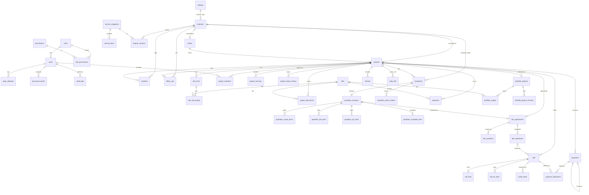

# Database Design — Entity-Relationship Diagram and Table-by-Table Specification

**Status: PROPOSED — PENDING APPROVAL (Stage 1 gate).**

This is a **design document, not SQL**. `database.sql` will be written in Stage 2, and only
after this design is approved.

- **Conventions:** follow `project-context/DATABASE_RULES.md` (InnoDB, utf8mb4, `snake_case`
  plural table names, `id` primary keys, real foreign keys with `RESTRICT`, DECIMAL for money).
- **Workflows:** follow `docs/WORKFLOWS.md`.

## 0. Notation

| Shorthand | Meaning |
|---|---|
| **PK** | primary key |
| **FK** | foreign key |
| **UQ** | unique |
| **IX** | indexed |
| **[STD]** | the standard audit columns: `created_at`, `created_by`, `updated_at`, `updated_by` |
| **[SD]** | soft-delete columns: `deleted_at`, `deleted_by` |
| **MONEY** | DECIMAL(14,2) |
| **RATE** | DECIMAL(12,2) |
| **AREA** | DECIMAL(12,2) |
| **PCT** | DECIMAL(5,2) |
| **QTY** | DECIMAL(10,2) |
| **status** | VARCHAR(30), checked against a fixed list in the application (D-07) |
| **lookup FK** | a reference to `lookups.id` for the given list type, checked by the application (D-06) |
| **signed MONEY** | negative values are allowed only on reversal rows |

**Totals:** 49 tables in 8 groups.
- Optional tables are marked ◇. They are created in the schema either way, so turning a
  feature on later does not require a schema change.

---

## 1. Entity-relationship diagram

Mermaid notation. Only relationships are shown; the columns are in §3.

---

## 2. Table list

| Group | Tables |
|---|---|
| A. Security & system (11) | `roles`, `permissions`, `role_permissions`, `users`, `login_attempts`, `password_resets`, `audit_logs`, `settings`, `number_sequences`, `lookups`, `files` |
| B. Services (2) | `service_categories`, `service_items` |
| C. CRM (5) | `clients`, `enquiries`, `enquiry_services`, `activities`, `follow_ups` |
| D. Projects (7) | `projects`, `project_members`, `project_services`, `project_status_history`, `site_visits`◇, `site_visit_photos`◇, `project_documents` |
| E. Quotations (7) | `quotations`, `quotation_revisions`, `quotation_scope_items`, `quotation_fee_lines`, `quotation_tax_lines`◇, `quotation_schedule_lines`◇, `quotation_status_history` |
| F. Finance (12) | `fee_agreements`, `fee_variations`, `fee_milestones`◇, `bills`◇, `bill_lines`◇, `bill_tax_lines`◇, `credit_notes`◇, `payments`, `payment_allocations`, `refunds`◇, `write_offs`◇, `expenses`◇ |
| G. Portfolio (3) | `portfolio_projects`, `portfolio_project_services`, `portfolio_images` |
| H. Website utilities (2) | `whatsapp_click_counts`, `form_submission_log` |

---

## 3. Table-by-table design

### A. Security & system

**A1 `roles`** — id · `code` VARCHAR(20) UQ (ADM/STF/ACC/SITE) · `name` · `description` ·
`is_system` (cannot be deleted) · `is_active` · [STD] [SD]

**A2 `permissions`** — id · `module` VARCHAR(40) · `action` VARCHAR(20) (V/C/E/D/S/A/R/X) ·
`description`. UQ(`module`, `action`). Seeded at install; the application never edits it.

**A3 `role_permissions`** — `role_id` FK · `permission_id` FK. PK(`role_id`, `permission_id`).

**A4 `users`**

| Column | Notes |
|---|---|
| `role_id` | FK → `roles` |
| `full_name` | |
| `username` | UQ |
| `email` | UQ |
| `mobile` | |
| `password_hash` | VARCHAR(255) |
| `must_change_password` | |
| `is_active` | |
| `failed_login_count` | |
| `locked_until` | DATETIME NULL |
| `last_login_at`, `last_login_ip` | |
| `totp_secret_enc` | ◇ NULL, encrypted (Q-U3) |
| | [STD] [SD] |

**A5 `login_attempts`** (BIGINT id) — `username_tried` · `user_id` NULL · `ip_address`
VARCHAR(45) · `user_agent` · `was_success` · `created_at`. IX on (`ip_address`,
`created_at`) and (`username_tried`, `created_at`). Old rows are cleaned up by cron.

**A6 `password_resets`** — `user_id` FK · `token_hash` CHAR(64) UQ · `expires_at` ·
`used_at` NULL · `request_ip` · `created_at`.

**A7 `audit_logs`** (BIGINT id) — exactly as `DATABASE_RULES.md` §8: `user_id` · `action` ·
`module` · `record_type` · `record_id` · `summary` · `old_values` JSON · `new_values` JSON ·
`ip_address` · `user_agent` · `created_at`. The application only ever inserts rows.
IX on (`module`, `record_type`, `record_id`) and (`created_at`).

**A8 `settings`** — `setting_key` VARCHAR(80) UQ · `setting_value` TEXT · `value_type`
(string/int/bool/json/money) · `setting_group` (studio, letterhead, numbering, tax, website,
security, finance) · `updated_at` · `updated_by`.
- Holds: the studio profile, letterhead text, website content blocks, SEO defaults,
  `billing_mode` (Q-F1), `tax_enabled`, `rounding_mode`, `lock_date`, the on/off switch for
  each optional feature, session timeouts, and the WhatsApp number.

**A9 `number_sequences`** — `seq_key` UQ (enquiry, project, quotation, bill, credit_note,
receipt, refund, expense) · `format` VARCHAR(60) · `reset_period` (never/year/fy) ·
`current_period` VARCHAR(10) · `last_number` INT.
- The row is locked while a number is taken, inside the same transaction as the document
  that uses it (`DATABASE_RULES.md` §6).

**A10 `lookups`** (D-06) — `list_type` VARCHAR(30) · `code` VARCHAR(40) · `label` ·
`sort_order` · `is_active` · `is_system` (cannot be deleted) · [STD] [SD].
UQ(`list_type`, `code`).
- **List types:** `enquiry_source`, `project_type`, `payment_mode`, `expense_category`,
  `document_category`, `site_visit_stage`, `area_unit`, `lost_reason`, `close_reason`,
  `reversal_reason`, `portfolio_category`.
- **Starting values** that come from the sample quotation are flagged so they can be checked
  later.

**A11 `files`**

| Column | Notes |
|---|---|
| `storage_area` | `public` or `private` |
| `relative_path` | |
| `stored_name` | CHAR(32) + extension, UQ |
| `original_name` | |
| `mime_type` | |
| `size_bytes` | |
| `sha256` | CHAR(64) |
| `width`, `height` | NULL; images only |
| `uploaded_by`, `created_at` | |

`DATABASE_RULES.md` §9 applies. There is no soft delete; a file is unlinked through its
owning record.

### B. Services

**B1 `service_categories`** — `name` · `slug` UQ · `description` · `website_title` ·
`website_description` · `show_on_website` · `sort_order` · `is_active` · `is_reference_seed`
(from the sample, not yet confirmed — Q-S1) · [STD] [SD]

**B2 `service_items`** — `service_category_id` FK · `name` · `default_description` ·
`default_unit` (lump sum / sq.ft / sq.m / per visit / per room / per sheet) ·
`default_rate` RATE NULL · `show_on_website` · `sort_order` · `is_active` ·
`is_reference_seed` · [STD] [SD]

### C. CRM

**C1 `clients`**

| Column | Notes |
|---|---|
| `client_type` | individual / company / trust / institution |
| `name` | IX |
| `contact_person` | |
| `mobile` | IX |
| `alt_mobile` | |
| `email` | IX |
| `address`, `city`, `pin` | |
| `gstin` | NULL (Q-F3) |
| `notes`, `is_active` | |
| | [STD] [SD] |

Cannot be soft-deleted if any project of this client has a financial record.

**C2 `enquiries`**

| Column | Notes |
|---|---|
| `enquiry_no` | UQ |
| `enquiry_date` | |
| `source_id` | lookup FK |
| `name`, `mobile`, `email` | |
| `location` | |
| `project_type_id` | lookup FK, NULL |
| `approx_area` | AREA NULL |
| `area_unit` | |
| `budget_text` | NULL |
| `message` | TEXT |
| `preferred_contact` | phone/whatsapp/email |
| `consent_at` | DATETIME NULL |
| `assigned_to` | FK → `users`, NULL |
| `status` | IX |
| `lost_reason_id`, `close_reason_id`, `status_note` | |
| `next_follow_up_at` | IX |
| `client_id` | FK NULL |
| `project_id` | FK NULL |
| `duplicate_of_id` | FK → `enquiries`, NULL |
| `is_website` | |
| `submitter_ip_hash` | CHAR(64) NULL |
| | [STD] [SD] |

**C3 `enquiry_services`** — `enquiry_id` FK · `service_category_id` FK.
PK(`enquiry_id`, `service_category_id`).

**C4 `activities`** — `enquiry_id` · `client_id` · `project_id` · `quotation_id` (all FK, NULL;
at least one must be set — checked by the application) · `activity_type` (note / call /
meeting / site_visit / status_change / email) · `activity_at` · `summary` TEXT ·
`created_by` · `created_at`. Rows are only ever added.

**C5 `follow_ups`** — `enquiry_id` · `project_id` · `quotation_id` · `bill_id` (FK, NULL; at
least one must be set) · `due_at` IX · `assigned_to` FK · `note` · `outcome` NULL ·
`done_at` NULL · `done_by` NULL · [STD] [SD]

### D. Projects

**D1 `projects`**

| Column | Notes |
|---|---|
| `project_code` | UQ |
| `name` | |
| `client_id` | FK |
| `enquiry_id` | FK NULL |
| `project_type_id` | lookup FK |
| `site_address`, `city` | |
| `plot_area` | AREA NULL |
| `built_up_area` | AREA NULL |
| `area_unit` | |
| `floors` | TINYINT NULL |
| `start_date` | NULL |
| `expected_completion` | NULL |
| `status` | IX |
| `notes` | |
| | [STD] [SD] |

**D2 `project_members`** — `project_id` FK · `user_id` FK · `role_on_project` VARCHAR(40).
PK(`project_id`, `user_id`). Used for the SITE role's record-level access.

**D3 `project_services`** — `project_id` FK · `service_category_id` FK. PK on both.

**D4 `project_status_history`** — `project_id` FK · `from_status` · `to_status` · `remark` ·
`changed_by` · `changed_at`.

**D5 `site_visits`** ◇ (Q-P3) — `project_id` FK · `visit_date` · `stage_id` lookup FK ·
`visited_by` FK → `users` · `observations` TEXT · `is_chargeable` ◇ ·
`bill_line_id` FK NULL ◇ · [STD] [SD]

**D6 `site_visit_photos`** ◇ — `site_visit_id` FK · `file_id` FK (private) · `caption` ·
`sort_order`.

**D7 `project_documents`** — `project_id` FK · `category_id` lookup FK · `title` ·
`version_label` · `document_date` · `file_id` FK (private) · `supersedes_id` FK →
`project_documents`, NULL · `notes` · [STD] [SD]

### E. Quotations

**E1 `quotations`**

| Column | Notes |
|---|---|
| `quotation_no` | UQ |
| `enquiry_id`, `project_id`, `client_id` | FK, NULL; enquiry or project required |
| `current_revision_no` | |
| `status` | IX — mirrors the current revision |
| `accepted_revision_id` | FK NULL |
| | [STD] — no soft delete; the Cancelled status is used instead |

**E2 `quotation_revisions`** — UQ(`quotation_id`, `revision_no`)

| Column | Notes |
|---|---|
| `quotation_id` | FK |
| `revision_no` | |
| `revision_date` | |
| `valid_until` | NULL |
| `status` | |
| `subject`, `intro_text` | |
| `site_location` | |
| `area` | AREA NULL |
| `area_basis` | built-up / carpet / plot / all-floors / other (Q-Q3) |
| `area_unit` | |
| `subtotal` | MONEY |
| `discount_type` | none/amount/percent |
| `discount_value` | |
| `discount_amount` | MONEY |
| `taxable_amount` | MONEY |
| `tax_amount` | MONEY |
| `rounding_mode` | |
| `rounding_amount` | MONEY |
| `grand_total` | MONEY |
| `amount_in_words` | |
| `terms_text`, `exclusions_text`, `bank_details_text` | |
| `show_*` | on/off flags, one per optional block |
| `letterhead_snapshot` | JSON — the studio details as printed |
| `sent_at`, `sent_by` | |
| `approved_at`, `approved_by` | ◇ |
| `decided_at`, `decided_by`, `decision_remark` | |
| | [STD] |

The application blocks any change once `status` ≠ Draft.

**E3 `quotation_scope_items`** — `revision_id` FK · `section_title` · `item_text` ·
`service_category_id` NULL · `service_item_id` NULL · `inclusion`
(included/optional/excluded) · `sort_order`.

**E4 `quotation_fee_lines`** — `revision_id` FK · `line_type` (area / area_category / fixed /
item / custom) · `description` · `service_category_id` NULL · `quantity` QTY NULL · `unit` ·
`area` AREA NULL · `rate` RATE NULL · `amount` MONEY · `sort_order`.

**E5 `quotation_tax_lines`** ◇ — `revision_id` FK · `tax_name` · `sac_code` NULL ·
`rate_pct` PCT · `amount` MONEY.

**E6 `quotation_schedule_lines`** ◇ — `revision_id` FK · `stage_name` · `percent` PCT NULL ·
`amount` MONEY · `trigger_text` · `sort_order`.

**E7 `quotation_status_history`** — `quotation_id` FK · `revision_id` FK · `from_status` ·
`to_status` · `remark` · `changed_by` · `changed_at`.

### F. Finance
Every row is permanent. Corrections use `reverses_id`, cancellation or a credit note
(`WORKFLOWS.md` B).

**F1 `fee_agreements`**

| Column | Notes |
|---|---|
| `project_id` | FK, UQ (one per project — PROPOSED) |
| `quotation_revision_id` | FK NULL |
| `agreement_date` | |
| `base_amount` | MONEY |
| `tax_amount` | MONEY |
| `original_total` | MONEY |
| `manual_reason` | NULL |
| `status` | active / closed / cancelled |
| | [STD] |

**F2 `fee_variations`** — `fee_agreement_id` FK · `variation_date` · `amount` (signed MONEY)
· `reason` · `quotation_revision_id` NULL · `approved_by` · [STD]

**F3 `fee_milestones`** ◇ — `fee_agreement_id` FK · `stage_name` · `percent` NULL ·
`amount` MONEY · `trigger_text` · `due_date` NULL · `sort_order` · [STD]

**F4 `bills`** ◇

| Column | Notes |
|---|---|
| `bill_no` | UQ, NULL while Draft |
| `bill_type` | demand_note / tax_invoice (Q-F3) |
| `project_id`, `client_id` | FK |
| `fee_milestone_id` | NULL |
| `bill_date`, `due_date` | |
| `status` | Draft / Issued / Cancelled; "partly paid" and "paid" are calculated |
| `subtotal`, `discount_amount`, `taxable_amount`, `tax_amount`, `rounding_amount`, `grand_total` | MONEY |
| `client_snapshot` | JSON |
| `notes` | |
| `issued_at`, `issued_by` | |
| `cancelled_at`, `cancelled_by`, `cancel_reason` | |
| | [STD] |

**F5 `bill_lines`** ◇ — `bill_id` FK · `line_type` · `description` · `quantity` · `unit` ·
`rate` · `amount` · `site_visit_id` NULL · `expense_id` NULL · `sort_order`.

**F6 `bill_tax_lines`** ◇ — the same columns as E5, with `bill_id`.

**F7 `credit_notes`** ◇ — `credit_note_no` UQ · `bill_id` FK · `note_date` · `amount` ·
`tax_amount` · `total` · `reason` · `status` (issued / cancelled) · `issued_by/at` ·
`cancelled_by/at` · [STD]

**F8 `payments`**

| Column | Notes |
|---|---|
| `receipt_no` | UQ |
| `entry_type` | payment / reversal |
| `payment_date` | IX |
| `client_id`, `project_id` | FK |
| `amount` | signed MONEY |
| `mode_id` | lookup FK |
| `reference_no`, `bank_name`, `notes` | |
| `reverses_id` | FK → `payments`, NULL, UQ (a payment can be reversed only once) |
| `reversal_reason_id`, `reversal_note` | |
| | [STD] |

**F9 `payment_allocations`** — `payment_id` FK · `bill_id` FK NULL · `fee_milestone_id` FK
NULL · `amount` (signed MONEY) · `allocation_date` · `reverses_id` FK NULL · `reason` NULL ·
[STD]

**F10 `refunds`** ◇ (Q-F9) — `refund_no` UQ · `refund_date` · `client_id` · `project_id` ·
`amount` (signed) · `mode_id` · `reference_no` · `reason` · `approved_by` · `reverses_id` ·
[STD]

**F11 `write_offs`** ◇ (D-13) — `project_id` · `bill_id` NULL · `fee_agreement_id` NULL ·
`write_off_date` · `amount` (signed) · `reason` · `approved_by` · `reverses_id` · [STD]

**F12 `expenses`** ◇ (Q-F8)

| Column | Notes |
|---|---|
| `expense_no` | UQ |
| `expense_date` | IX |
| `category_id` | lookup FK |
| `project_id` | NULL — blank means office overhead |
| `paid_to` | |
| `amount` | signed MONEY |
| `mode_id` | |
| `reference_no` | |
| `file_id` | NULL — attached bill |
| `is_reimbursable` | ◇ |
| `notes` | |
| `reverses_id`, `reversal_reason` | |
| | [STD] |

### G. Portfolio

**G1 `portfolio_projects`**

| Column | Notes |
|---|---|
| `project_id` | FK NULL — the internal project it comes from |
| `title` | |
| `slug` | UQ |
| `category_id` | lookup `portfolio_category` |
| `location_text` | city level only |
| `short_description` | |
| `long_description` | sanitised rich text |
| `completion_year` | NULL |
| `area`, `area_unit`, `show_area` | `show_area` is off by default |
| `cover_image_id` | FK → `portfolio_images`, NULL |
| `is_featured` | |
| `is_published` | IX |
| `published_at`, `published_by` | |
| `consent_confirmed` | ◇ (Q-W5) |
| `consent_note` | |
| `consent_confirmed_by/at` | |
| `seo_title`, `seo_description` | |
| `sort_order` | |
| | [STD] [SD] |

**G2 `portfolio_project_services`** — `portfolio_project_id` FK · `service_category_id` FK.

**G3 `portfolio_images`** — `portfolio_project_id` FK · `file_id` FK (public; resized
versions are found by naming convention) · `alt_text` (required) · `caption` ·
`show_in_gallery` (R-02) · `sort_order` · [STD] [SD]

### H. Website utilities

**H1 `whatsapp_click_counts`** — `click_date` · `page_key` · `click_count` INT.
PK(`click_date`, `page_key`). No personal data (C-05).

**H2 `form_submission_log`** (BIGINT id) — `form_key` · `ip_hash` CHAR(64) ·
`created_at` IX. Used for rate limiting. Rows are deleted after 7 days (PROPOSED).

---

## 4. Integrity rules the application must enforce
(Enforced in PHP. Database triggers are optional — D-15.)

1. Posted or issued financial rows are never updated, except for status and cancellation
   fields.
2. `payments.amount`, `refunds.amount`, `expenses.amount` and `write_offs.amount` are
   negative **only** when `reverses_id` is set, and then equal to minus the original amount.
3. Total allocations per payment ≤ the payment amount. Total allocations per bill ≤ the bill's
   grand total − its credit notes.
4. One active fee agreement per project. One accepted revision per quotation.
5. Quotation revisions are frozen once their status ≠ Draft.
6. Every financial write and every number taken from a sequence happen in the same
   transaction.
7. Nothing is soft-deleted if financial rows refer to it; it is deactivated instead.

## 5. Indexing and volume
- Expected size: a 1–5 user studio, a few thousand rows per year (ASSUMPTION A1). Every
  linking, status and date column is indexed (`DATABASE_RULES.md` §2).
- Full-text search is not planned; `LIKE` searches on name, mobile and code are enough.

## 6. Decisions affecting this design — PENDING APPROVAL
D-06 generic lookups · D-07 status handling · D-15 database triggers · D-04 separate
database logins · Q-F1 billing mode · Q-F3 tax · Q-F9 refunds · D-13 write-offs ·
Q-P3 site visits · Q-W5 consent · Q-W8 Marathi (would add translated text columns).
